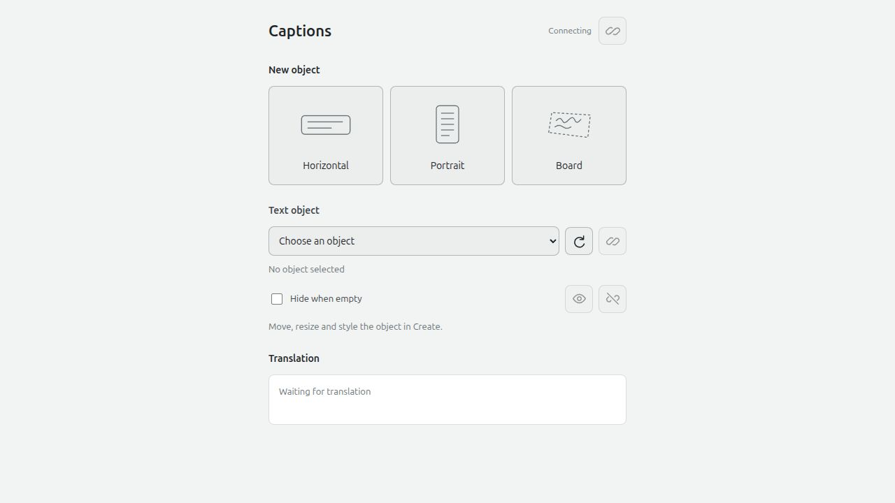
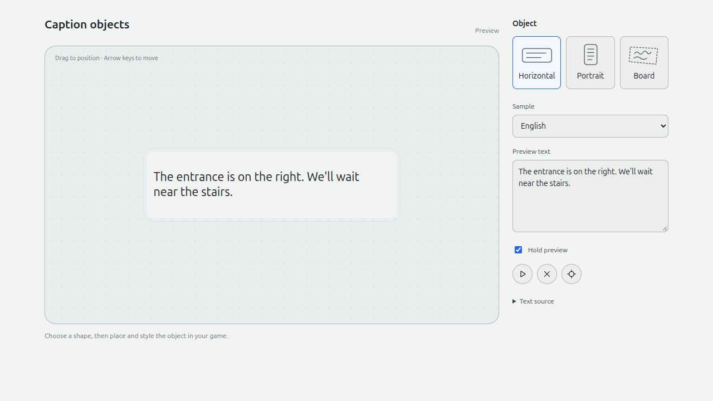

<h1 align="center">XRT-Avatar-Plugin</h1>

  <a href="https://github.com/NowLoadY/XRT-Avatar-Plugin/releases/tag/v0.1.0-preview.4">Download</a> ·
  <a href="#install">Install</a> ·
  <a href="docs/README.md">Help</a>

Start and stop [XRTranslate](https://github.com/NowLoadY/XRTranslate) from your avatar's menu or in-game controls. Choose your microphone, languages and translation output in XRTranslate, then use the controls while you play.

In Overte, create a caption object or connect one you have designed. Place it on a prop, a board or your avatar, and adjust its font, color and shape with the game's editing tools.

## Previews

Overte's caption page provides object presets, selection and preview controls. The page below is shown before connecting to the game.

  

Horizontal caption layout preview:

  

Portrait caption layout preview. You can also use transparent board lettering and your own fonts and artwork in supported games.

  

## Install

**Host requirement:** this preview needs XRTranslate with **Avatar translation controls**, planned for **0.3.4**. The current **0.3.3** release cannot connect to the plugin. See [XRTranslate setup](https://github.com/NowLoadY/XRTranslate/blob/main/docs/avatar-connectors.md) for the available development setup.

Choose the package for your game:

| Game | Download | What you get | Setup |
|---|---|---|---|
| VRChat | [Unity package](https://github.com/NowLoadY/XRT-Avatar-Plugin/releases/download/v0.1.0-preview.4/XRT-Avatar-Plugin-VRChat-0.1.0-preview.4.unitypackage) | Avatar translation menu | [Unity / VCC](docs/adapters/vrchat/installation.md) |
| ChilloutVR | [Unity package](https://github.com/NowLoadY/XRT-Avatar-Plugin/releases/download/v0.1.0-preview.4/XRT-Avatar-Plugin-ChilloutVR-0.1.0-preview.4.unitypackage) | Avatar translation toggle | [CCK project](docs/adapters/chilloutvr/installation.md) |
| Overte | [Script bundle](https://github.com/NowLoadY/XRT-Avatar-Plugin/releases/download/v0.1.0-preview.4/XRT-Avatar-Plugin-Overte-0.1.0-preview.4.zip) | Tablet controls and caption objects | [Load in Overte](docs/adapters/overte/installation.md) |

1. **Install in your game project.** For VRChat or ChilloutVR, import the Unity package, open **Tools → XRT-Avatar-Plugin**, add the controls to your avatar and upload it with the game's SDK. For Overte, extract the bundle and load its script through **Running Scripts**.
2. **Connect XRTranslate.** Open **Settings → Plugins → Avatar translation controls**, select your game and enable the plugin. Follow your game's setup guide to enable OSC or pair its controls.
3. **Start in the game.** Use **XRT → Translation** in VRChat, **XRT Translation** in ChilloutVR, or the tablet's play icon in Overte. Use the same control to stop.

Caption objects shown above are available in Overte. The VRChat and ChilloutVR packages add menu controls; choose their translation output in XRTranslate.

[Resonite](docs/adapters/resonite/installation.md) and [Second Life](docs/adapters/secondlife/installation.md) have separate setup guides. Resonite needs a session with ResoniteLink enabled; Second Life needs a configured relay service.

The packages are development previews. Unity import and live game checks are still pending.

## Help

See the [game guides](docs/README.md#player-guides) for setup, changing your objects and removing the plugin. For a problem, [open an issue](https://github.com/NowLoadY/XRT-Avatar-Plugin/issues) and include your game, plugin version and the step that failed.

## License

[AGPL-3.0-only](LICENSE). Independent community project.
