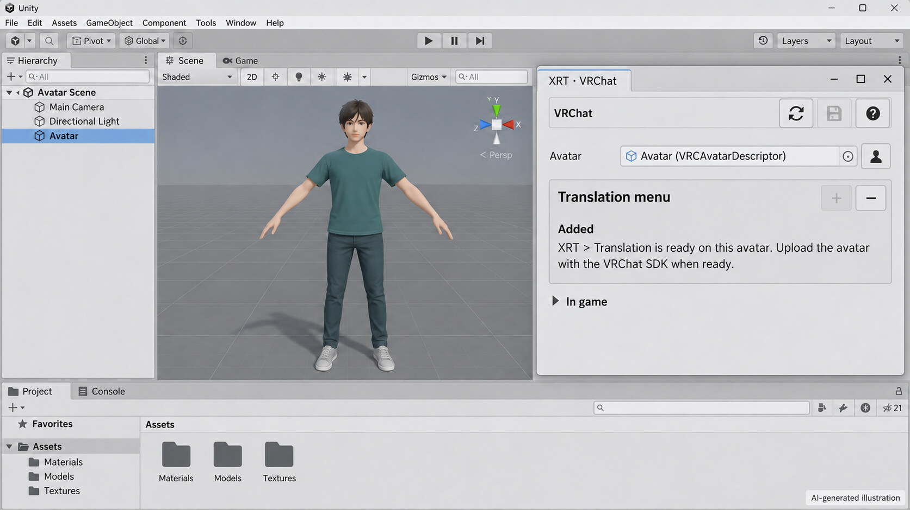
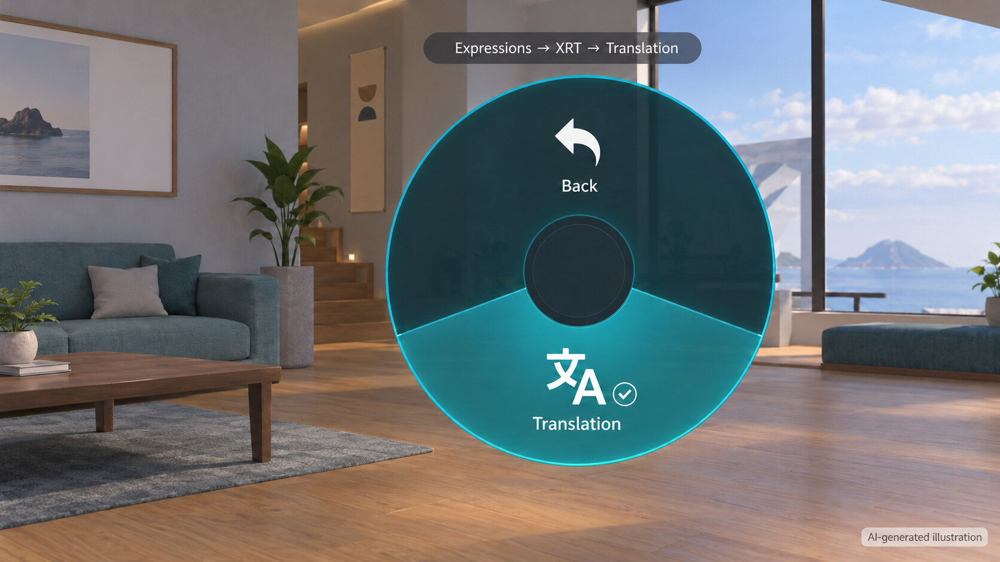
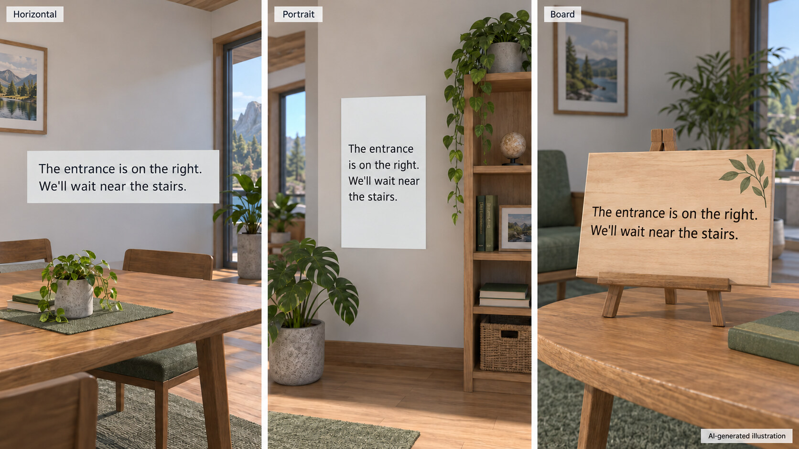

<h1 align="center">XRT-Avatar-Plugin</h1>

  <a href="https://github.com/NowLoadY/XRT-Avatar-Plugin/releases/tag/v0.1.0-preview.4">Download</a> ·
  <a href="#install">Install</a> ·
  <a href="docs/README.md">Guides</a>

Start and stop [XRTranslate](https://github.com/NowLoadY/XRTranslate) from your avatar's menu or in-game controls. Display translations on editable text objects in Overte and Resonite, or on attachments in Second Life.

## Preview

*AI-generated illustrations.*

**Unity · VRChat avatar setup**

Select your avatar, add the translation menu and upload through the VRChat SDK.

  

**VRChat · Translation switch**

Open **Expressions → XRT → Translation** to start or stop translation while you play.

  

**Overte · Caption objects**

Create a horizontal or portrait text object, or place the text on your own board or artwork. Use Overte's Create tools to position it and adjust its appearance.

  

## Install

**Requires XRTranslate > 0.3.3.**

Choose your game and follow its setup guide:

| Game | Features | Download | Setup |
|---|---|---|---|
| VRChat | Avatar translation menu | [Unity package](https://github.com/NowLoadY/XRT-Avatar-Plugin/releases/download/v0.1.0-preview.4/XRT-Avatar-Plugin-VRChat-0.1.0-preview.4.unitypackage) | [Unity / VCC](docs/adapters/vrchat/installation.md) |
| ChilloutVR | Avatar translation toggle | [Unity package](https://github.com/NowLoadY/XRT-Avatar-Plugin/releases/download/v0.1.0-preview.4/XRT-Avatar-Plugin-ChilloutVR-0.1.0-preview.4.unitypackage) | [CCK project](docs/adapters/chilloutvr/installation.md) |
| Overte | Tablet controls and caption objects | [Script bundle](https://github.com/NowLoadY/XRT-Avatar-Plugin/releases/download/v0.1.0-preview.4/XRT-Avatar-Plugin-Overte-0.1.0-preview.4.zip) | [Running Scripts](docs/adapters/overte/installation.md) |
| Resonite | Avatar controls and caption objects | [Source archive](https://github.com/NowLoadY/XRT-Avatar-Plugin/archive/refs/tags/v0.1.0-preview.4.zip) | [ResoniteLink](docs/adapters/resonite/installation.md) |
| Second Life | Attachment controls and captions | [Source archive](https://github.com/NowLoadY/XRT-Avatar-Plugin/archive/refs/tags/v0.1.0-preview.4.zip) | [Attachment / relay](docs/adapters/secondlife/installation.md) |

In XRTranslate, set your audio input, languages and outputs. Open **Settings → Plugins → Avatar translation controls**, select your game and enable the plugin. Follow your game's guide to connect it and use the translation switch.

## Help

The [game guides](docs/README.md#game-guides) cover setup, customization and removal. To report a problem, [open an issue](https://github.com/NowLoadY/XRT-Avatar-Plugin/issues) with your game, plugin version and the step that failed.

## License

[AGPL-3.0-only](LICENSE). Independent community project.
