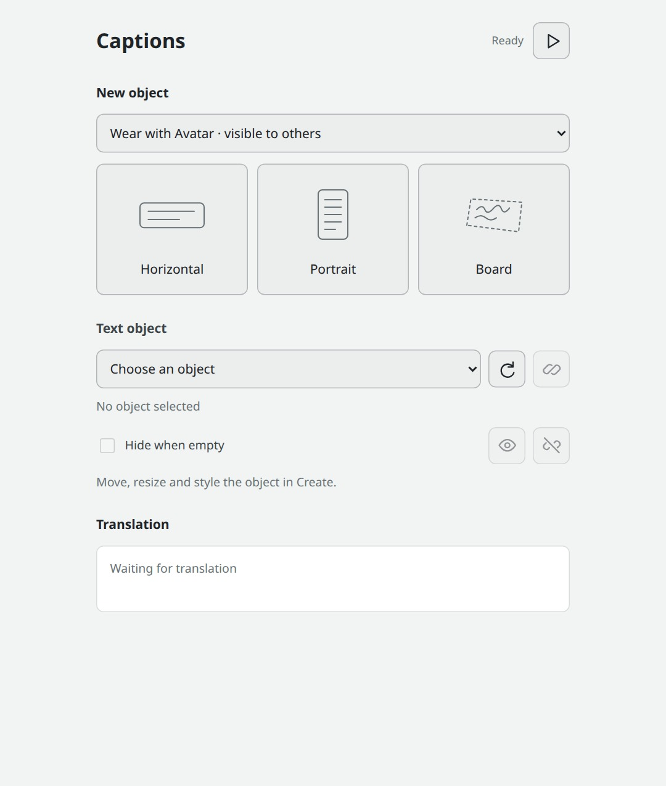

# Install in Overte

Use the tablet to control translation and display captions on an object you can
place and style yourself.

## Install and connect

1. Download and extract [the Overte script bundle](https://github.com/NowLoadY/XRT-Avatar-Plugin/releases/download/v0.1.0-preview.7/XRT-Avatar-Plugin-Overte-0.1.0-preview.7.zip).
2. Start XRTranslate on the same computer. In **Avatar**,
   select **Overte**, enable the plugin and **Display content**.
   Keep the connection address and pairing token available.
3. In Overte, open **Edit → Running Scripts → From Disk** and select
   `adapters/overte/scripts/xrt-avatar.js` inside the extracted folder. Keep the
   rest of the extracted files in place.
4. Open the tablet and select the **link icon**. Paste the address and pairing
   token from XRTranslate. Connecting leaves translation off.

## Start and stop

Select the **play icon** to start translation. It becomes a **square** that stops
translation or cancels startup. The square is highlighted while translation is
running.

Hover over an icon to see its action. An hourglass means the control is waiting.
The arrow retries after an error; the link reconnects after a lost connection.
After changing Avatar or visiting another domain, connect again and press play.
Copy a fresh pairing token from XRTranslate when needed.

## Add captions

Open **Caption objects** using the tablet's display icon. Choose **Wear with
Avatar** for a caption others can see, or **Only me** for a personal object. Select
a card to create and connect it:

| Object | Appearance |
| --- | --- |
| Horizontal | A wide, light caption panel. |
| Portrait | A narrow panel with horizontal lines of text. |
| Board | Transparent text to place on your own board or drawing surface. |

The object appears in front of your Avatar. In **Create → Entity List**, choose
it by name; enable **Local entities** to find personal objects. Use Create to
move, rotate and resize it, then edit its font, colors, margins and background.
Avatar objects move with you; personal objects stay where you place them. Work in
a location where Create is available.

To use an existing object, choose it from the **Text object** list and select the
**link icon**. The list shows editable Text objects within 30 meters and whether
others can see them. Select **refresh** after adding or moving an object.
Choose **All text**, **Header**, **Messages** or **Footer** as the object's text source.

Use the **eye icon** to keep sample text visible while editing. Select it again
to end the preview; starting translation also ends it. **Hide when empty** hides
the object between captions. The **broken-link icon** disconnects the object and
restores its previous text and visibility while keeping your design.

The audience selector applies to new objects. Binding an existing object keeps
its placement and audience. Avatar objects use the domain's Avatar-object
permission. Export from Create to keep a reusable design; personal objects last
for the current Interface session.

## Appearance

Live text preserves the object's position, size, font and colors. It wraps to
fit, with an ellipsis when it is too long. Messages disappear after their display
time in XRTranslate. Stopping translation removes its messages; a configured
header or footer remains until its source is cleared or the connection closes.

New objects use the included Noto caption font, loaded over HTTPS, for common
Chinese, Japanese, Korean, Latin, Greek and Cyrillic text. For a handwritten or
illustrated sign, place Board text on your artwork and choose a compatible font
in Create.

## Remove and restore

Stop the script in **Running Scripts**. Its tablet controls disappear, translation
stops and the bound object's previous text is restored. Objects you created or
edited remain available.

To use it again, load `xrt-avatar.js` and reconnect. The previous object binding is
reused if the object still exists.

For Avatar script installation or custom displays, see the
[development guide](https://github.com/NowLoadY/XRT-Avatar-Plugin/blob/main/docs/adapters/overte/development.md).
