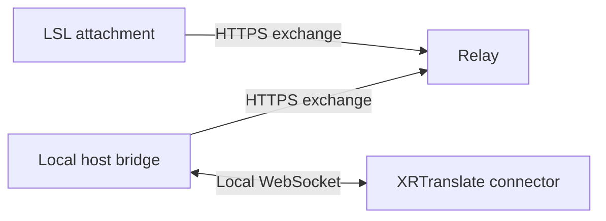

# Second Life

The Second Life adapter provides translation controls on a wearable attachment.
Only the owner can use the touch control. XRTranslate supplies actual session
state through the [shared connector protocol](../../connector-protocol.md).

## Components

The relay routes messages for one configured pair. Separate client and host
tokens identify each direction. It retains bounded queues in memory and expires
inactive peers after 15 seconds. It stores no transcript history. Queue overflow,
peer changes and expired leases invalidate the exchange generation, discard
pending messages and restart the connector handshake from Off.

The local bridge owns transport connections. XRTranslate owns session requests,
resource acquisition and cancellation. Relay responses acknowledge delivery;
only XRTranslate state establishes whether translation is active. The attachment
also enforces the host-message deadline independently of relay availability.

## Platform lifecycle

Attachment, owner changes, region changes and teleportation create a fresh
attachment instance. Translation remains Off until the owner requests it after
connection reconciliation. Detach attempts to stop the session; the expiring
lease covers logout and callbacks that cannot finish before derez. The
[`attach` event](https://wiki.secondlife.com/wiki/Attach) does not run on region
crossings or teleportation, which are handled through
[`changed`](https://wiki.secondlife.com/wiki/Changed).

Only one HTTP request is in flight. Polling is spaced two seconds apart. A
throttled request enters a silent 45-second backoff. Requests and responses are
matched by request identifier. Transport failures start a new exchange generation
so earlier commands are discarded. These choices follow the simulator's
[`llHTTPRequest` limits](https://wiki.secondlife.com/wiki/LlHTTPRequest) and
[`http_response` behavior](https://wiki.secondlife.com/wiki/Http_response).

## Presentation

The attachment shows its connection and translation status. Optional hover
captions are controlled by the attachment setting; they share the session's
lifetime and expire automatically. World attachment text is visible to nearby
residents. The [`llSetText` API](https://wiki.secondlife.com/wiki/LlSetText) limits
text to 254 UTF-8 bytes, and its text remains on the prim when a script is removed.
Clear the text before removing the adapter or use a dedicated attachment prim.

## Compatibility

The source uses documented LSL JSON, HTTP, attachment and touch APIs. The relay
requires Python 3.10 or later; the local bridge requires Node.js 22.4 or later.
Source and protocol checks do not establish an in-world simulator or viewer
compatibility result. See [installation](installation.md) for setup and a focused
in-world acceptance procedure.
