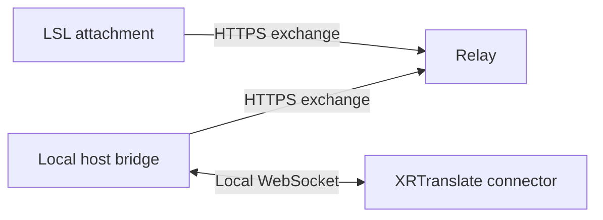

# Second Life

The Second Life adapter provides translation controls and text regions on a wearable attachment.
Touch opens compact controls for the owner. XRTranslate supplies actual session
state through the [shared connector protocol](../../connector-protocol.md).

## Components

The relay routes messages for one configured pair. Separate client and host
tokens identify each direction. It retains bounded queues in memory and expires
inactive peers after 15 seconds. It stores no transcript history. Queue overflow,
peer changes and expired leases invalidate the exchange generation, discard
pending messages and restart the connector handshake from Off.

The local bridge validates `display-v1` snapshots through the shared text source.
Snapshots contain a header, up to eight messages and a footer. Each queue keeps
only its latest snapshot; buffering and response retries reduce each message's
remaining lifetime. Headers and footers persist until replaced or disconnected.
Legacy caption frames use the shared caption projection.

XRTranslate owns session requests,
resource acquisition and cancellation. Relay responses acknowledge delivery;
only XRTranslate state establishes whether translation is active. The attachment
also enforces the host-message deadline independently of relay availability.

## Platform lifecycle

Attachment, owner changes, region changes and teleportation create a fresh
attachment instance. Translation remains Off until the owner requests it after
connection reconciliation. Detach attempts to stop the session; the expiring
lease covers logout and callbacks that cannot finish before derez. The
[`attach` event](https://wiki.secondlife.com/wiki/Attach) does not run on region
crossings or teleportation, which are handled through
[`changed`](https://wiki.secondlife.com/wiki/Changed).

Only one HTTP request is in flight. Polling is spaced two seconds apart. A
throttled request enters a silent 45-second backoff. Requests and responses are
matched by request identifier. Transport failures start a new exchange generation
so earlier commands are discarded. These choices follow the simulator's
[`llHTTPRequest` limits](https://wiki.secondlife.com/wiki/LlHTTPRequest) and
[`http_response` behavior](https://wiki.secondlife.com/wiki/Http_response).

## Presentation

The attachment shows status in an owner-only dialog with Start, Stop and Close
controls. A listener accepts the current dialog action for 30 seconds and is
invalidated on reset, reconnection and detach. The official
[`llDialog` API](https://wiki.secondlife.com/wiki/LlDialog) provides text buttons.

`SHOW_CAPTIONS` enables hover text on the control prim. `PUBLISH_TEXT_SOURCE`
independently enables text delivery to scripts in the attachment's linkset. Both
default to false. Either advertises `display-v1` and legacy captions. With
`SHOW_CAPTIONS` disabled, the controller leaves that prim's hover text untouched.

The bridge preserves source line breaks and applies shared text sanitization.
A display snapshot is bounded to 8192 UTF-8 bytes, including metadata. Overflow
shortens text at grapheme boundaries. Messages contain up to 256 characters and
expire independently within 15 seconds; banners contain up to 128 characters.
Exchanges carry at most four frames within a 12288-byte HTTP envelope.

Native hover text keeps soft-white lettering and the viewer's font and background
behavior. [`llSetText`](https://wiki.secondlife.com/wiki/LlSetText) provides text,
color and opacity, with a 254-byte UTF-8 limit. A dedicated receiver can show the
full display or just the header, messages or footer. Its prim remains editable in
Build.

Global revisions order full snapshots. Clearing retains the revision fence;
a new connection resets it. Translation Stop and control reconciliation retain
banners while XRTranslate removes the stopped task's messages. Disconnect,
detach and an explicit display clear remove all regions.

Legacy caption frames remain supported with a 2048-byte encoded limit and an
eight-second lifetime. `XRT_CAPTION_PRESET` chooses their shared `horizontal`,
`vertical` or `board` wrapping. Native hover text does not draw lettering onto a
prim surface.

## Text source

The [connector manifest](../../../adapters/secondlife/connector.json) owns the
linked-message fields. When enabled, the controller sends JSON through
[`llMessageLinked`](https://wiki.secondlife.com/wiki/LlMessageLinked) to `LINK_SET`
with message number `1481790465`. All scripts in that linkset can receive it.
`header`, `messages` and `footer` expose the separate regions. Each message has
an `id`, `text` and remaining `ttl_ms`. `text` also supplies the combined unwrapped
value; `display_text` is its bounded native hover projection. `revision` identifies
the host snapshot.

`expires_ms` is the receiver lease. The controller renews it while connected;
zero clears the receiver. Each message also expires by its own `ttl_ms`, so a
persistent header cannot keep an old message alive. Receivers clear on detach
and region changes. The lease clears a dedicated receiver if its controller
script stops.

[`XRT-TextDisplay.lsl`](../../../adapters/secondlife/attachment/XRT-TextDisplay.lsl)
owns hover text on its dedicated prim. Place it in an existing editable prim of
the same linkset and arrange the prim in Build. Set `REGION` to `full`, `header`,
`messages` or `footer`. A custom lettering renderer can consume the structured
regions or combined `text`; it owns its geometry, font and layout.
Native hover text remains on a prim after its script is removed, so clear it
before removing the receiver. See [installation](installation.md).

## Compatibility

The source uses documented LSL JSON, HTTP, attachment and touch APIs. The relay
requires Python 3.10 or later; the local bridge requires Node.js 22.4 or later.
Source and protocol checks do not establish an in-world simulator or viewer
compatibility result. See [installation](installation.md) for setup and
[development](development.md#in-world-checks) for the in-world acceptance procedure.
