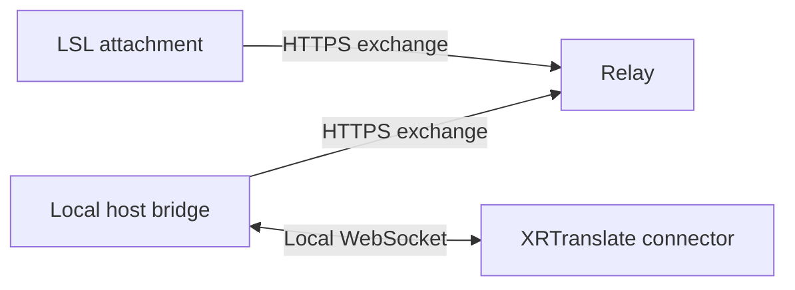

# Second Life

The Second Life adapter provides translation controls on a wearable attachment.
Touch opens compact controls for the owner. XRTranslate supplies actual session
state through the [shared connector protocol](../../connector-protocol.md).

## Components

The relay routes messages for one configured pair. Separate client and host
tokens identify each direction. It retains bounded queues in memory and expires
inactive peers after 15 seconds. It stores no transcript history. Queue overflow,
peer changes and expired leases invalidate the exchange generation, discard
pending messages and restart the connector handshake from Off.

The local bridge owns transport connections and derives the native caption
projection from the shared layout. It also carries an unwrapped text source for
custom displays. Both bridge and relay subtract time spent buffering a caption
from its remaining lifetime. Each queue retains only its latest caption.

XRTranslate owns session requests,
resource acquisition and cancellation. Relay responses acknowledge delivery;
only XRTranslate state establishes whether translation is active. The attachment
also enforces the host-message deadline independently of relay availability.

## Platform lifecycle

Attachment, owner changes, region changes and teleportation create a fresh
attachment instance. Translation remains Off until the owner requests it after
connection reconciliation. Detach attempts to stop the session; the expiring
lease covers logout and callbacks that cannot finish before derez. The
[`attach` event](https://wiki.secondlife.com/wiki/Attach) does not run on region
crossings or teleportation, which are handled through
[`changed`](https://wiki.secondlife.com/wiki/Changed).

Only one HTTP request is in flight. Polling is spaced two seconds apart. A
throttled request enters a silent 45-second backoff. Requests and responses are
matched by request identifier. Transport failures start a new exchange generation
so earlier commands are discarded. These choices follow the simulator's
[`llHTTPRequest` limits](https://wiki.secondlife.com/wiki/LlHTTPRequest) and
[`http_response` behavior](https://wiki.secondlife.com/wiki/Http_response).

## Presentation

The attachment shows status in an owner-only dialog with Start, Stop and Close
controls. A listener accepts the current dialog action for 30 seconds and is
invalidated on reset, reconnection and detach. The official
[`llDialog` API](https://wiki.secondlife.com/wiki/LlDialog) provides text buttons.

`SHOW_CAPTIONS` enables hover text on the control prim. `PUBLISH_TEXT_SOURCE`
independently enables text delivery to scripts in the attachment's linkset. Both
default to false. Either enables the connector's caption capability. With
`SHOW_CAPTIONS` disabled, the controller leaves that prim's hover text untouched.

The bridge preserves source line breaks and applies shared text sanitization.
It bounds the complete encoded caption frame to 2048 UTF-8 bytes, including
metadata and both text fields. Overflow shortens the source at a grapheme boundary
and adds an ellipsis; the native projection is derived from that bounded source.

`XRT_CAPTION_PRESET` selects `horizontal`, `vertical` or `board` from the
[shared presets](../../../presentation/presets.json). The default is `horizontal`.
For native hover text these select wrapping and line count only. `vertical` is a
narrow multiline layout; `board` does not create handwriting or text on a prim
surface. Native captions keep soft-white text and the viewer's font and
background behavior. [`llSetText`](https://wiki.secondlife.com/wiki/LlSetText)
provides text, color and opacity, with a 254-byte UTF-8 limit.

Duplicate revisions and updates to replaced results cannot restore expired
captions. Identity history is bounded and reset with the session. Stopping,
clearing, reconciling the connection or changing the attachment lifecycle clears
the display and publishes an empty source. The receiver also expires each value
independently, with a maximum lifetime of eight seconds.

## Text source

The [connector manifest](../../../adapters/secondlife/connector.json) owns the
linked-message fields. When enabled, the controller sends JSON through
[`llMessageLinked`](https://wiki.secondlife.com/wiki/LlMessageLinked) to `LINK_SET`
with message number `1481790465`. All scripts in that linkset can receive it.
`text` is unwrapped source text; `display_text` is the native hover projection;
`expires_ms` is the remaining lifetime. Empty text with zero lifetime clears the
consumer. Updates replace the previous value; receivers must expire their own
display and handle detach and region changes.

[`XRT-TextDisplay.lsl`](../../../adapters/secondlife/attachment/XRT-TextDisplay.lsl)
owns hover text on its dedicated prim. Place it in an existing editable prim of
the same linkset and arrange the prim in Build. A custom lettering renderer can
consume `text` instead; such a renderer owns its geometry, font and layout.
Native hover text remains on a prim after its script is removed, so clear it
before removing the receiver. See [installation](installation.md).

## Compatibility

The source uses documented LSL JSON, HTTP, attachment and touch APIs. The relay
requires Python 3.10 or later; the local bridge requires Node.js 22.4 or later.
Source and protocol checks do not establish an in-world simulator or viewer
compatibility result. See [installation](installation.md) for setup and
[development](development.md#in-world-checks) for the in-world acceptance procedure.
