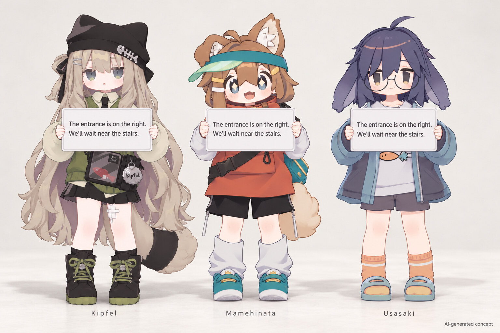

# VRChat presentation

A future Avatar-attached translation bubble is an independent presentation
adapter. The current package contains no bubble renderer, font atlas, shader or
text-paging protocol. Existing XRTranslate overlays and VRChat Chatbox remain the
available output paths.

## Board placement concept

Full-body placement studies with a white board held at chest height.

Character references: [Kipfel](https://mukumi.booth.pm/items/5813187),
[Mamehinata](https://mukumi.booth.pm/items/4340548) and
[Usasaki](https://mukumi.booth.pm/items/3550881) by もち山金魚 / @mukumi.
[Kipfel detail](images/kipfel-board-concept.jpg).

## Ownership

The adapter consumes normalized translation results with their owner, message
identity, revision, language and preview/final status. It preserves replacement
and cancellation semantics. It does not start translation, own audio or models,
or reconstruct results from visible UI text.

Presentation policy owns audience, placement, lifetime and a bounded text budget.
The shared transport encodes accepted updates; installed Avatar assets render
those updates. Adding presentation does not change the control state machine or
create another OSC listener.

## Runtime representation

VRChat's [Avatar component allowlist](https://creators.vrchat.com/avatars/whitelisted-avatar-components/whitelisted-avatar-components/)
permits meshes, materials, animators and supported constraints. It does not
provide an Avatar TextMeshPro component, Udon runtime or custom MonoBehaviour
runtime. The world's TextMeshPro API is not an Avatar text binding.

An Avatar presentation backend must compile an authoring layout into supported
assets: a bounded glyph mesh, font atlas, material/shader and animator bindings.
XRTranslate performs text layout and encodes glyph updates through the existing
OSC owner. The installed Avatar consumes numeric values. A source binding in
the editor denotes that complete route; it cannot be implemented by serializing
a string field on an editor-only component.

Horizontal, vertical and board presets describe geometry, placement and layout.
They share the same text source and lifecycle. A preset is installable only when
its generated assets and its host encoder implement the same renderer contract.
Changing the preset does not create a second translation session.

## Resource accounting

The renderer declares its font coverage, visible glyph count, material and
texture requirements, animator cost and parameter use. Editor preview and host
encoding use the same glyph mapping and layout bounds. Missing glyphs use a
specified replacement; the package must not claim arbitrary Unicode coverage
from a fixed atlas.

Local OSC float values retain 32-bit precision in animators. Synchronized floats
are quantized, and all custom synchronized parameters share a 256-bit budget.
Local and shared renderers therefore require separate encoding and cost checks;
simply enabling parameter synchronization does not make a local renderer a
shared renderer. A 32-slot, one-byte-per-slot shared buffer alone uses all
256 bits, before any framing or visibility state. Standard custom parameter
synchronization is not a reliable ordered text stream. See the official
[parameter types and synchronization rules](https://creators.vrchat.com/avatars/animator-parameters/).

## Target and visibility

The initial bubble target is the wearer's own Avatar. It is not an API for
attaching objects to other players. Local visibility is the default; sharing
requires an explicit source and audience setting. Mixed system audio provides
neither per-player identity nor a different translation for each viewer.

Avatar parameters carry numeric values rather than arbitrary text. A renderer
therefore needs its own bounded encoding and declared character/font capability;
`/chatbox/input` cannot update an arbitrary Avatar text component. Text encoding,
resource cost and platform support must be established with that renderer before
its parameters become part of a public contract.

## Result lifetime and appearance

Committed text is suitable for shared output. Local output may use replaceable
previews when the renderer supports revisions. Replacement, expiry and owner
cancellation clear pending content; reconnect must not resurrect old text.

The visual package follows the [shared presentation style](../../presentation-architecture.md)
for typography, spacing, restrained color, placement and expiry. It declares actual Avatar resource cost
and its platform fallback. Neither PC shader compatibility nor remote visibility
can be inferred for standalone Android or another user's safety settings.

Official boundaries: [Avatar parameters](https://creators.vrchat.com/avatars/animator-parameters/),
[OSC Chatbox](https://docs.vrchat.com/docs/osc-as-input-controller),
[Android Avatar restrictions](https://creators.vrchat.com/platforms/android/quest-content-limitations/).
