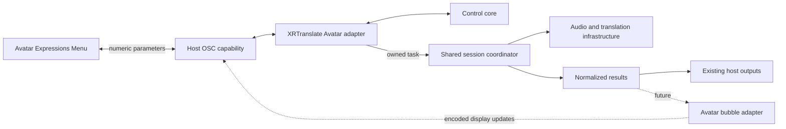

# Architecture

XRT-Avatar-Plugin connects Avatar interaction to host capabilities. The Avatar
package is an authoring extension; it does not execute arbitrary C# inside
VRChat. XRTranslate remains the runtime host.

## Ownership

| Owner | Responsibility |
|---|---|
| Avatar editor package | Validate installation, preserve existing assets, generate menu/parameters, restore owned changes |
| Control core | Request state, binding generations, operation identity, typed effects and actual-state transitions |
| XRTranslate Avatar adapter | Compose the core, validate host readiness, map actions to owned sessions, return runtime outcomes |
| XRTranslate OSC capability | Discovery, one receive transport, decoded events, snapshots, parameter writes and connection lifetime |
| Shared XRTranslate infrastructure | Audio graph, language policy, recognition, translation, model scheduling, history and TTS |
| Presentation adapters | Consume normalized results and render within their declared visibility and platform capabilities |

The core has no sockets, threads, clocks, persistence, UI, audio devices or
model dependencies. It returns effects; it never receives the root application
object. The host executes those effects in order and supplies actual outcomes.
Shared recognition and protocol code must not branch on the Avatar plugin name.

XRTranslate uses statically linked built-in plugins. Source in this repository
is not a dynamically loaded desktop plugin. Its host adapter is registered and
released with XRTranslate, using a pinned version or revision of the core.
Unity package and host adapter releases declare protocol compatibility separately.

## Resource lifetime

Registration, user permission to accept Avatar control, transport availability
and an active translation session are separate states. Disabling Chatbox output
does not revoke the control transport while another consumer needs it.

The host owns resource acquisition. A plugin session has an opaque operation
owner that survives asynchronous startup and cancellation. Its exclusive live
input lease rejects overlapping work without taking over another session.
Cancellation stops that owner's input and invalidates its pending output; the
owner and lease remain until its workers have exited. Unrelated tasks retain
their resources. Shutdown cleanup belongs to each resource owner. No adapter
creates a second model pool or duplicate audio pipeline.

The desktop plugin owns control state; the host's `avatar_host` module composes
sessions through neutral coordinator contracts. The OSC capability owns the
shared receive transport for all consumers. See [host integration](host-integration.md)
for the implementation boundary and [control protocol](control-protocol.md) for
binding and reset semantics.

Installation creates project-local assets and leaves source Avatar assets
intact. Removal restores original descriptor references only when ownership is
still verifiable. Changes made by the Avatar author take precedence over cleanup.

## Extension

Control and presentation have separate contracts. Adding a bubble renderer
does not change translation startup or transport ownership. Adding another game
requires a concrete game adapter for its official capabilities; it does not
justify game-specific branches in recognition or a new generic plugin framework.

Official boundaries: [allowed Avatar components](https://creators.vrchat.com/avatars/whitelisted-avatar-components/whitelisted-avatar-components/),
[OSC](https://docs.vrchat.com/docs/osc-overview),
[VPM packages](https://vcc.docs.vrchat.com/vpm/packages/).
