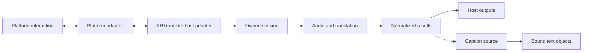

# Architecture

XRT-Avatar-Plugin connects Avatar interaction in virtual social platforms to
XRTranslate. Platform adapters implement the interaction and control supported
by each platform. XRTranslate provides the translation runtime.

## Ownership

| Owner | Responsibility |
|---|---|
| Platform adapter | SDK integration, installation assets, game interaction and display |
| Connector SDK | Connector catalogue, generated transport contracts, pure text codecs and lifecycle |
| Connector client | Pairing, framing, heartbeat and session validation |
| XRTranslate host adapter | Validate requests, compose host capabilities and return actual operation state |
| XRTranslate session infrastructure | Session ownership, input acquisition, cancellation and resource cleanup |
| XRTranslate translation infrastructure | Audio, recognition, translation, scheduling and normalized results |
| Caption source | Expose header, messages, footer and their plain-text projections independently of display |
| Presentation adapter | Bind native fields and create editable objects within platform permissions |

Host adapters use existing session and output contracts. Resource owners manage
their lifetimes; translation infrastructure stays independent of platform
implementations. The [host integration contract](host-integration.md) defines
request ownership and cleanup. The [presentation contract](presentation-architecture.md)
defines shared appearance, result lifetime and native rendering ownership.

## Repository layout

| Path | Contents |
|---|---|
| `adapters/<platform>/` | Platform code, packages, protocol definitions, tools and examples |
| `docs/adapters/<platform>/` | Platform installation, protocol, compatibility and host integration |
| `docs/` | Repository architecture and common host contracts |
| `crates/connector-core/` | I/O-free connector SDK: catalogue, contracts, text codecs and lifecycle |
| `connectors/catalog.json` | Public connector identities and transport selection |
| `connectors/websocket/` | Common JavaScript and Python wire clients |
| `authoring/unity/` | Shared Unity controls window, caption presets and material preview; SDK installers remain in adapters |
| `presentation/` | Text sources, layouts, authoring styles and SDK-independent Unity glyph rendering |
| `tools/` | Generated bindings, shared asset synchronization, release packaging and visual preview |
| `third_party/` | Pinned reference source with upstream provenance and licenses |

The host selects one connector and retains one lifecycle controller across
connection changes. VRChat and ChilloutVR use profiles of XRTranslate's OSCQuery
transport. Overte, Resonite and Second Life use the [local connector protocol](connector-protocol.md).
Platform bridges adapt game APIs to this protocol. ResoniteLink and Second Life's
HTTP relay remain explicit platform-specific branches.

XRTranslate depends on `xrt-connector-core` at a pinned repository revision.
`tools/generate_protocol.py` builds its catalogue and OSC contracts from the
connector catalogue and platform manifests. The SDK performs pure capability
checks and text encoding; the host supplies typed snapshots and performs I/O.
The small platform control crates preserve their existing Rust interfaces.
OSC Chatbox sending, formatting and destination settings belong to XRTranslate's
OSC plugin; game adapters consume existing host outputs where applicable.

Each adapter declares its supported platform capabilities, installation method,
protocol and compatible host versions. Public protocol and package identity
changes are versioned with their host requirements. SDK and transport details
remain within that adapter. Shared abstractions follow concrete contracts
established by implemented adapters.

Installation records identify contributed menu controls, parameters, animation
layers, receivers and text objects through assigned assets and components.
Unity adapter edits copy the affected asset graph and switch only the selected
Avatar's references. Removal changes owned contributions in those working copies,
preserving user additions. Previous assets remain available for Undo/Redo and
saved scenes, including scenes that are not open. Inspection does not create
assets. Platform-specific installation rules belong to the adapter guide.

The Unity window template shares selection, status, save and Undo interaction.
`adapters/<platform>/unity-editor.json` supplies SDK bindings and labels.
`tools/generate_unity_editor.py` emits the two SDK-specific windows; release
packaging checks that these copies match. Each installer owns its validation,
asset creation and restoration. Caption windows reuse `CaptionAuthoring` and
`CaptionPreview` while retaining their platform-specific selection and install actions.
`authoring/unity/AssetCopies.cs` copies explicitly selected asset files and their
sub-assets, remaps references and cleans up unsuccessful copies. Adapters choose
the assets and own the operation's Undo transaction. Shared textures and unrelated
external assets retain their existing references.

Text display is one full snapshot with header, visible messages and footer.
Message expiry is independent of banner updates. Host output plugins select
content; the companion SDK and receivers own region layout, native binding and
buffered chunk updates. OSC and Avatar share the host's internal TextOutputPlugin
for formatting and system sampling while retaining independent preferences.

The Unity caption renderer is shared source under `presentation/unity/`. An
installable adapter receives a checked resource copy and provides its own
synchronization and installation bindings. Game-specific code never enters the
shared renderer. Reference repositories are separate from release inputs.
