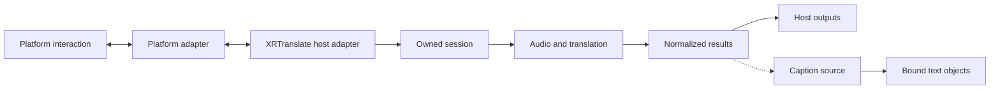

# Architecture

XRT-Avatar-Plugin connects Avatar interaction in virtual social platforms to
XRTranslate. Platform adapters implement the interaction and control supported
by each platform. XRTranslate provides the translation runtime.

## Ownership

| Owner | Responsibility |
|---|---|
| Platform adapter | SDK integration, installation assets, game interaction and display |
| Connector core | Shared reset, intent, operation identity and lifecycle rules |
| Connector client | Pairing, framing, heartbeat and session validation |
| XRTranslate host adapter | Validate requests, compose host capabilities and return actual operation state |
| XRTranslate session infrastructure | Session ownership, input acquisition, cancellation and resource cleanup |
| XRTranslate translation infrastructure | Audio, recognition, translation, scheduling and normalized results |
| Caption source | Expose current plain text and result lifetime independently of its display |
| Presentation adapter | Bind native fields and create editable objects within platform permissions |

Host adapters use existing session and output contracts. Resource owners manage
their lifetimes; translation infrastructure stays independent of platform
implementations. The [host integration contract](host-integration.md) defines
request ownership and cleanup. The [presentation contract](presentation-architecture.md)
defines shared appearance, result lifetime and native rendering ownership.

## Repository layout

| Path | Contents |
|---|---|
| `adapters/<platform>/` | Platform code, packages, protocol definitions, tools and examples |
| `docs/adapters/<platform>/` | Platform installation, protocol, compatibility and host integration |
| `docs/` | Repository architecture and common host contracts |
| `crates/connector-core/` | I/O-free lifecycle shared by every platform |
| `connectors/websocket/` | Common JavaScript and Python wire clients |
| `authoring/unity/` | Shared Unity window template; SDK-specific installers remain in adapters |
| `presentation/` | Text source, optional layout, preset profiles and authoring styles |
| `tools/` | Generated bindings, release packaging and visual preview |

The host selects one connector and retains one lifecycle controller across
connection changes. VRChat and ChilloutVR use profiles of XRTranslate's OSCQuery
transport. Overte, Resonite and Second Life use the [local connector protocol](connector-protocol.md).
Platform bridges adapt game APIs to this protocol. ResoniteLink and Second Life's
HTTP relay remain explicit platform-specific branches.

The `xrt-avatar-control` crate preserves the VRChat dependency interface and
re-exports the shared lifecycle. Platform crates own generated parameter
constants. Host dependencies are pinned to a companion repository revision.
OSC Chatbox sending, formatting and destination settings belong to XRTranslate's
OSC plugin; game adapters consume existing host outputs where applicable.

Each adapter declares its supported platform capabilities, installation method,
protocol and compatible host versions. SDK and transport details remain within
that adapter. Shared abstractions follow concrete contracts established by
implemented adapters.

Installation preserves user-authored assets and records ownership of generated
changes. Scene references determine whether an installation is active; records
and generated assets remain available for Undo/Redo and previously saved scenes.
Adding again copies the current source assets. Removal restores references only
while ownership remains verifiable. Platform-specific installation rules belong
to the adapter guide.

The Unity window template shares selection, status, save and Undo interaction.
`adapters/<platform>/unity-editor.json` supplies SDK bindings and labels.
`tools/generate_unity_editor.py` emits the two SDK-specific windows; release
packaging checks that these copies match. Each installer owns its validation,
asset creation and restoration.
