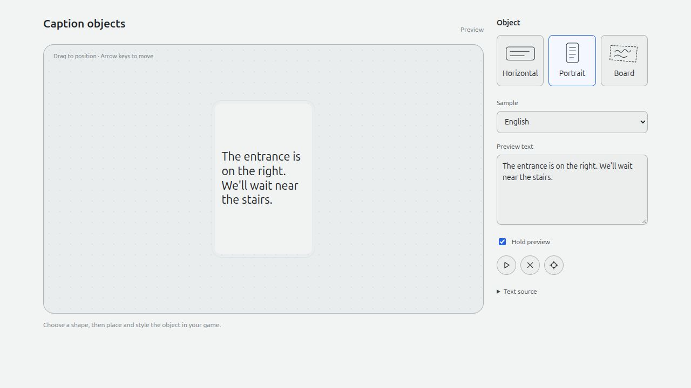

# Layout preview

[`tools/preview-presentation.html`](../../tools/preview-presentation.html) is a
browser tool for editing sample text and checking the shared caption layouts.
It uses the JavaScript text source, preset profiles and light theme from
[`presentation/`](../../presentation/).

From the repository root:

```sh
python3 -m http.server 8000 --bind 127.0.0.1
```

Open `http://127.0.0.1:8000/tools/preview-presentation.html`. Choose a layout and
sample, or enter your own text. Drag the object or use the arrow keys to move it.
**Hold preview** keeps the sample visible while editing; **Text source** shows
the text before display wrapping.

## Horizontal


## Portrait


